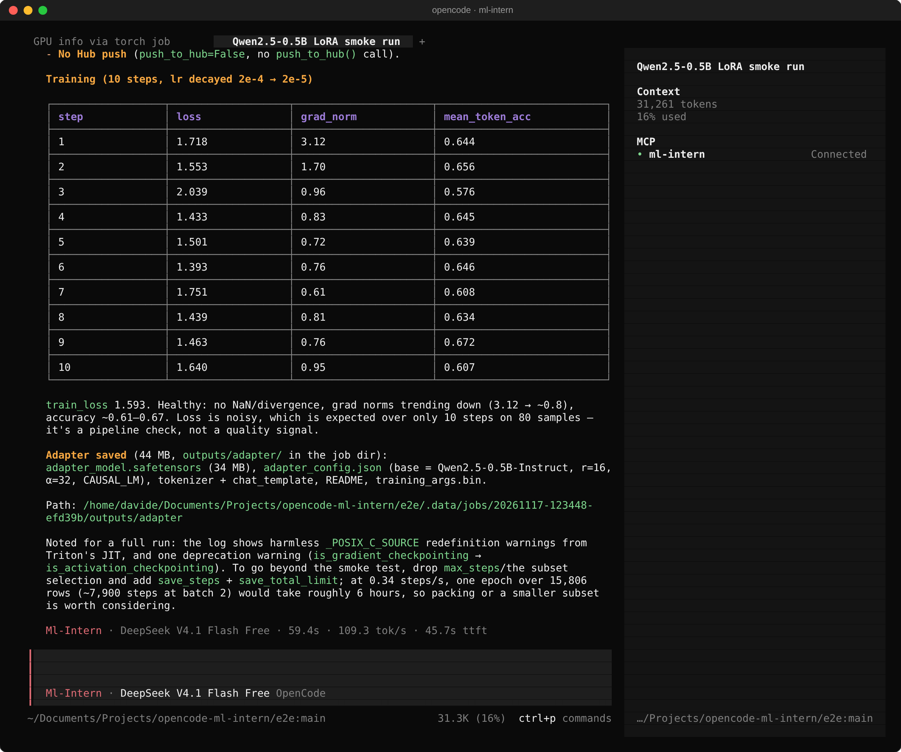
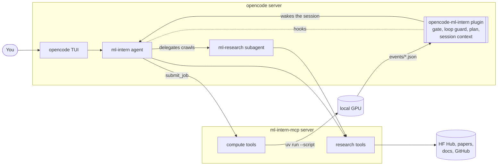
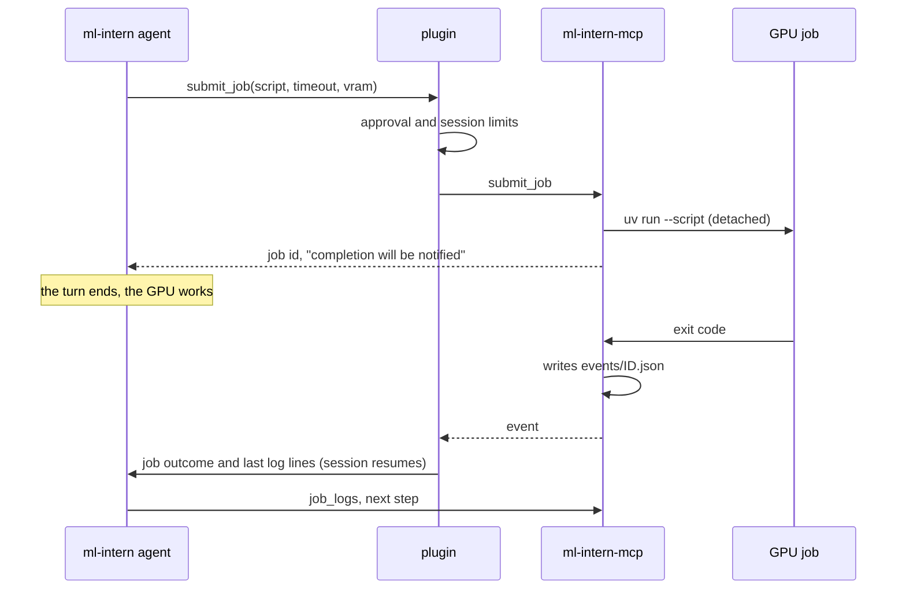
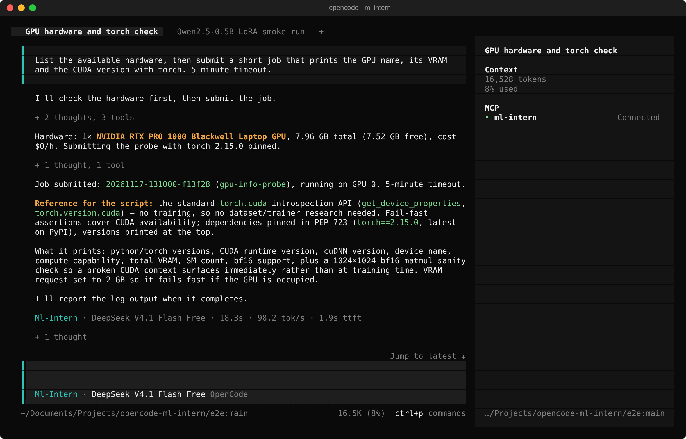
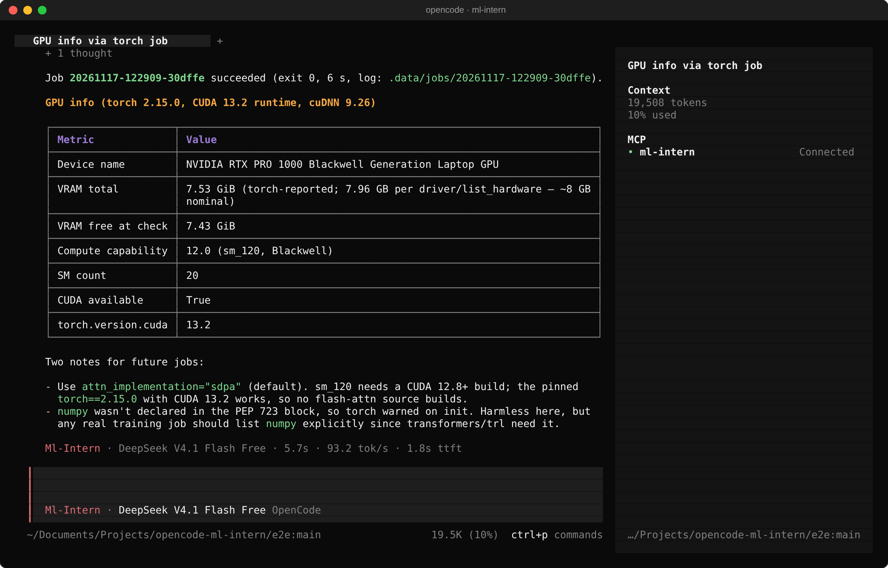

# opencode-ml-intern

An ML engineering agent for [opencode](https://opencode.ai) V2, inspired by Hugging Face's [ml-intern](https://github.com/huggingface/ml-intern). Ask it for a fine-tune: it reads papers, docs and datasets, writes the training script, runs it as a job on your GPU and picks the work up again when the job ends.



It is made of two packages:

| Package | What it is |
|---|---|
| [`plugin/`](plugin/README.md) | The opencode plugin `opencode-ml-intern`: agents, prompt, skills, compute gate, loop guard and job notifications |
| [`server/`](server/README.md) | The MCP server `ml-intern-mcp`: research tools (papers, HF docs, datasets, GitHub) and GPU compute tools |

## Install

```sh
opencode plugin add opencode-ml-intern
```

Requirements: opencode 2.3.0, [uv](https://docs.astral.sh/uv/) and an NVIDIA GPU for training jobs. The plugin registers the MCP server itself. Select the `ml-intern` agent (Tab in the TUI) and describe the training you want.

## For your coding agent

Paste this prompt into your coding agent (opencode, Claude Code, Codex...) to set up ML Intern from this repository:

```text
Set up opencode-ml-intern (https://github.com/davidemodolo/opencode-ml-intern) on this machine.

1. If the repository is not cloned yet, clone it into a folder of my choice (ask me where).
   If it is already cloned, use that copy and run `git pull`.
2. Check the requirements and install what is missing, asking me before installing system packages:
   - NVIDIA driver (`nvidia-smi` works; skip if the machine has no NVIDIA GPU)
   - uv (https://docs.astral.sh/uv/)
   - Node.js 26 (the repository has a .nvmrc; with nvm: `nvm install` in the repository root)
   - opencode 2.3.0 (`npm install -g @opencode/cli@2.3.0`)
3. In the repository root:
   - `cd server && uv sync && uv run pytest`
   - `cd plugin && npm ci && npm run build && npm test`
4. Add the plugin to my global opencode config (`~/.config/opencode/opencode.jsonc`, or under
   $XDG_CONFIG_HOME). Merge it with the existing content and keep my other settings. Use absolute
   paths to the cloned repository:
   "plugins": [{
     "package": "<repo>/plugin",
     "options": { "serverCommand": ["uv", "run", "--project", "<repo>/server", "ml-intern-mcp"] }
   }]
5. Run `opencode reload`, then check that `opencode debug agents --standalone` lists the
   `ml-intern` and `ml-research` agents.
6. Tell me what you installed and changed, and how to start: open opencode in a project and pick
   the ml-intern agent with Tab. A first test prompt: "List the available hardware".
```

## Hardware

Each job runs on a single GPU. On a machine with several GPUs, jobs run in parallel, one per GPU, and the rest wait in a queue; a job fits when its model and training state fit in the VRAM of one GPU. The per-session limits (`maxActiveJobs`, default 4, and `maxGpuHours`, default 24) are plugin options, see [`plugin/README.md`](plugin/README.md).

## How it works



1. The `ml-intern` agent delegates literature crawls to the `ml-research` subagent and checks datasets, models and current APIs with the research tools.
2. It writes a training script with inline PEP 723 dependencies and submits it with `submit_job`: a smoke run first, then the full run.
3. The server runs the job detached on the GPU, one job per GPU, and writes a completion event.
4. The plugin delivers the event to the session that submitted the job; the agent resumes, reads the logs and continues.

### A job, step by step



Jobs keep running when opencode or the MCP server restarts, and the event is delivered when the session comes back.

## What it looks like

The agent checks the hardware and submits a job:



When the job ends the session wakes up by itself with the outcome:



## Try it from this repository

`e2e/` is an opencode project wired to the local plugin and server, with its own config and data folders:

```sh
nvm use                                     # Node 26 from .nvmrc
(cd plugin && npm ci && npm run build)
cd e2e
XDG_CONFIG_HOME=$PWD/.config ML_INTERN_DATA_DIR=$PWD/.data opencode --standalone
```

Pick the `ml-intern` agent with Tab and try, from the quickest to the longest:

| Prompt | What it exercises |
|---|---|
| `List the available hardware` | GPU detection and free VRAM |
| `Submit a job that prints the GPU name and the CUDA version with torch, 5 minute timeout` | Submit, detached run, completion notice and resume |
| `Fine-tune Qwen/Qwen2.5-0.5B-Instruct with LoRA on trl-lib/Capybara, 10 steps, no Hub push` | Research, script writing, training and adapter saved |
| `/jobs` | Job summary of the session |

Jobs live in `e2e/.data/jobs/<id>/` (`script.py`, `stdout.log`, `job.json`, `outputs/`), so `tail -f e2e/.data/jobs/<id>/stdout.log` and `nvidia-smi` show a job while it runs. `e2e/opencode.jsonc` sets `autoApprove: true`; set it to `false` to get the approval prompt on every submission.

## Development

Requirements: Node.js 26 (see `.nvmrc`), Python 3.12+ and uv.

```sh
cd server && uv sync && uv run pytest
cd plugin && npm install && npm run build && npm test
node e2e/run.mjs --fresh   # end-to-end acceptance run on the local GPU
```

`node e2e/run.mjs` starts an isolated `opencode serve`, asks for a 10-step LoRA fine-tune and exits with 0 once an adapter is saved. `spikes/` holds the probes used to verify opencode behavior (results in `docs/spikes.md`). The roadmap is in `docs/plan-phase-1.md` (local GPU) and `docs/plan-phase-2.md` (cloud GPU providers and HF Jobs); open work is tracked in [`TODO.md`](TODO.md).

## License

Apache-2.0. See `LICENSE` and `NOTICE`.
